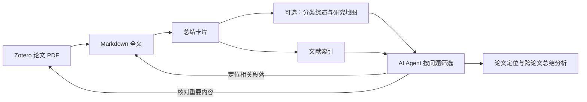

# ZoteroMinerU

**把 Zotero 论文 PDF 整理为 AI Agent 易于读取的 Markdown 资料，帮助快速定位相关论文及具体研究内容，进行跨论文总结、比较与分析。**

[下载安装](https://github.com/izjxnxn/ZoteroMinerU/releases/latest) · [详细使用手册](使用说明.md) · [常见问题](使用说明.md#faq) · [版本更新](https://github.com/izjxnxn/ZoteroMinerU/releases) · [开源许可证](LICENSE)

Zotero 中积累了很多 PDF，并不意味着 AI Agent 每次都能迅速找到其中与当前问题相关的研究方法、模型、参数、实验结果和结论。让代理反复打开整批 PDF、提取内容并阅读全文，会重复做解析工作，也容易把大量无关内容带入上下文。

ZoteroMinerU 的核心用途，是先把这些论文准备成 **Markdown 全文 → 结构化总结卡片 → 文献与研究地图索引**。代理可以先围绕科研问题筛选论文，再阅读相关论文的全文段落，最后回到 PDF 核对公式、图表和重要结论。这为“从自己的文献库中找研究内容、总结方法、比较工作、分析研究脉络”提供可读取、可追溯的资料。

软件同时提供双语 PDF、分类研究综述和新文献追踪，方便人工阅读与持续整理。生成的全文、总结和双语 PDF 可以直接回到原论文条目下，减少反复导出、改名和导入文件的操作。

它由 **Windows 桌面主程序 + Zotero 桥接插件** 组成。普通用户下载 ZIP 即可运行，不需要安装 Python；PDF 解析使用自己的 MinerU Token，总结和翻译使用自己选择的大模型服务。各项功能可按需使用，不必一次配置全部服务。

## 导航

- [能做什么](#features)
- [项目特色](#highlights)
- [适合怎样使用](#workflow)
- [让 AI Agent 使用文献库](#ai-agent)
- [下载与安装](#install)
- [首次使用](#quick-start)
- [功能需要哪些服务](#requirements)
- [文件保存与输出](#outputs)
- [数据、费用与适用范围](#boundaries)
- [开发与构建](#development)

<a id="features"></a>
## 能做什么

| 功能 | 输入 | 得到什么 |
|---|---|---|
| PDF 转 Markdown | Zotero 论文条目下的原文 PDF | `MD_作者_论文名称.md` 全文附件，图片内嵌 |
| AI 论文总结 | 已有 Markdown 全文 | `SUM_作者_论文名称.md` 总结卡片、可选 Zotero 笔记及索引 |
| 保留排版翻译 | 有文字层的英文原文 PDF | 左侧译文、右侧原文的双语 PDF，可选纯译文 PDF |
| 分类研究综述 | 分类中的总结卡片、摘要、题录与可用的引用关系 | 按分类组织的研究综述、研究地图与索引 |
| 新文献追踪 | 分类中的已有论文与检索线索 | 含相关度、推荐理由和 DOI 的新文献报告 |
| 文献任务管理 | Zotero 分类、论文及附件 | 批量勾选、进度查看、文件打开、失败重试及移入回收站 |

### 1. PDF 转 Markdown：把论文变成可阅读、可检索的全文

**为什么要转换？** PDF 主要承载固定页面上的阅读与展示，AI 工具使用它时通常还要提取文字、识别版面，处理双栏、图片和公式。提前转换为 Markdown，可以让支持文件读取的代理按标题、段落和文件内容检索，不必为每次研究问题重新解析同一批 PDF。Markdown 也为后续卡片、索引和跨论文分析提供统一输入。

只生成 Markdown，就可以交给支持本地文件的 AI 工具检索；进一步生成总结和索引后，代理可以先缩小阅读范围。具体速度与用量取决于文件、解析质量、模型和代理的读取方式，本项目不承诺固定的加速倍数。

- 从 Zotero 读取分类树及论文列表，可选择一个分类并包含其子分类。
- 调用 MinerU 云端解析 PDF，支持通过设置控制公式、表格和 OCR 等解析选项；解析质量由原文和服务结果决定。
- 把结果中的图片放回正文对应位置，以 Base64 内嵌到 Markdown 中，便于复制和交给支持该格式的阅读器或 AI 工具使用。
- 使用 Zotero 的命名结果生成 `MD_作者_论文名称.md`，并作为原论文的子附件添加回 Zotero。
- 对超过单任务页数限制的长 PDF，按页序分段处理并合并；不会因此取消服务端的文件大小限制。
- 原条目已有全文 Markdown 时跳过，避免重复提交；`SUM_` 总结卡片单独识别，不当作全文。

[查看转换步骤与保存规则 →](使用说明.md#convert)

### 2. AI 论文总结：从单篇全文得到有结构的阅读卡片

- 默认采用“精读全文”：先阅读全文形成初稿，再结合全文核对和补充；超长论文可按上下文限制分段处理。
- 卡片包括一句话总结、关键词，以及研究背景、研究目标、研究对象、研究方法、模型与理论、研究内容、研究结论七个部分。
- 总结正文默认上限为 3000 字，可调整；支持简体中文或英文输出。
- 可选择支持图片输入的模型，让模型结合论文插图阅读；图片输入会增加用量。
- 卡片带有 Zotero 条目、原文 PDF 和全文 Markdown 的关联信息，可同时生成 Zotero 笔记。
- 输出 `AI总结索引.md` 和 `ai_summaries.jsonl`，方便按“索引 → 卡片 → 全文”的顺序检索资料。

可以在转换完成后自动排队总结，也可以选中已有全文的论文后手动生成。模型总结仍需结合原文复核，尤其是公式、数值和研究结论。

[查看总结设置与操作步骤 →](使用说明.md#summary)

### 3. 双语 PDF：在原文旁边对照阅读译文

- 使用独立运行的 BabelDOC 引擎，在本机完成版面分析和排版，通过所选大模型翻译文字。
- 生成 `双语_作者_论文名称.pdf`：每页左侧为译文、右侧为原文，可在 Zotero 中阅读和批注。
- 提供字体选择、参考文献翻译开关、术语表及可选纯译文 PDF。
- 翻译前可提取专业术语，帮助统一全文译法；已有双语 PDF 时按识别规则跳过。
- 引擎包可在软件中下载，右下角显示下载、校验、解压配置进度，完成或失败均有弹窗提示。

当前流程面向有文字层的英文论文，译为简体中文。它以保留公式、图表和原页面元素为目标，但不承诺每篇论文排版完全一致；复杂版面、特殊字体或模型输出可能需要人工检查。

[查看翻译步骤、资源下载与网络问题 →](使用说明.md#translate)

### 4. 分类研究综述：从一组论文整理研究脉络

- 使用你已有的 Zotero 分类结构，先处理底层分类，再逐级汇总到上级分类。
- 优先读取 AI 总结卡片；没有卡片时使用摘要或题录，并记录资料覆盖情况。
- 结合可取得的论文引用关系，回读部分关键论文的 Markdown 内容，补充和核对综述。
- 输出研究对象、关键词、研究地图、研究脉络、研究进展、研究空白与论文清单。
- 同时生成 Markdown 综述、可选 HTML 时间轴地图，以及分类索引。
- 根据资料变化做增量更新，未变化的分类可复用已有结果。

综述与研究地图保存在输出目录的 `研究地图/` 中，不自动写入 Zotero。它适合辅助梳理已有文库，不能替代系统文献检索或人工核查。

[查看分类综述的开启与输出 →](使用说明.md#research)

### 5. 新文献追踪：围绕已有文库寻找相关论文

- 从 Semantic Scholar、OpenAlex 查询引用本分类论文的新论文、相似论文，以及满足配置条件时的关键词候选。
- 过滤文库已有及历史已处理的候选，结合可用的语义向量、引用线索和多样性进行筛选。
- 由大模型阅读候选的题录和可用摘要，给出相关度评分与推荐理由。
- 默认关注近 180 天，每分类每次最多列出 15 篇、最低相关度 6 分；均可在界面调整。
- 生成 `TRK_分类名.md` 报告，不自动下载候选全文或将推荐论文加入 Zotero。

结果取决于数据库覆盖、摘要可用性、API 权限和网络状态，不保证检索完整或推荐一定准确。正式使用 OpenAlex 查询前应配置自己的 API Key。

[查看新文献追踪与数据库 Key →](使用说明.md#tracking)

<a id="highlights"></a>
## 项目特色

- **围绕 Zotero 条目组织结果。** 全文、总结和双语 PDF 回到原论文下，按作者和标题命名，便于追溯资料来源。
- **由用户决定处理范围。** 选择分类只是列出论文；勾选论文并开启转换，或点击对应的总结、翻译按钮，才执行任务。转换批次结束后自动关闭开关。
- **全文与总结分层使用。** 单文件 Markdown 保存图文内容，结构化卡片和索引帮助先筛选相关论文，再阅读全文。
- **为 AI Agent 准备资料。** 把原本分散在 PDF 页面中的内容整理为可按文件和段落读取的全文，并保留回到论文条目和原文的关联信息，便于代理给出有来源的比较与分析。
- **从单篇阅读延伸到分类梳理。** 同一文库既可做全文处理，也可生成分类综述、研究地图和新文献报告。
- **模型可自行选择。** 提供 DeepSeek、通义千问、MiMo、Claude、OpenAI、Gemini、Kimi、GLM、硅基流动、OpenRouter、Ollama 及其他 OpenAI 兼容接口配置。可获取模型列表并测试连接。
- **任务状态可查看和恢复。** 转换、总结和翻译分别显示状态；支持去重、失败重试和部分阶段续接。已提交的外部请求仍受服务端状态和计费规则约束。
- **普通用户无需配置 Python。** Windows ZIP 包含主程序、插件、完整项目源码及许可证；较大的翻译引擎按需安装。

<a id="workflow"></a>
## 适合怎样使用



| 你的需求 | 使用路径 |
|---|---|
| 让 AI Agent 从自己的文献库找到相关研究内容 | 转换全文 → 准备卡片与索引 → 授权代理读取输出文件 → 按问题筛选和精读 |
| 将一个课题分类中的 PDF 整理成全文资料 | 选择分类 → 勾选论文 → 开始转换 → 查看 `MD_` 附件 |
| 快速了解一批论文，再决定精读哪些 | 先生成全文 → 生成 AI 总结 → 查索引与 `SUM_` 卡片 → 返回原文复核 |
| 对照阅读英文论文 | 配置大模型与翻译引擎 → 勾选原文 PDF → 生成双语 PDF |
| 梳理某个研究方向及其子方向 | 准备总结卡片 → 勾选研究分类 → 生成综述与 HTML 地图 |
| 定期了解相关新论文 | 配置文献数据库 Key → 设置追踪范围和周期 → 查看 `TRK_` 报告 |

<a id="install"></a>
## 下载与安装

**运行环境：Windows 10/11 x64、本机 Zotero 个人文库。** 插件声明支持 Zotero 7～10.0，实际验证版本为 9.0.6、10.0.6；其他版本未逐一验证。当前不提供 macOS、Linux 或 ARM 专用安装包。

前往 [GitHub Releases](https://github.com/izjxnxn/ZoteroMinerU/releases/latest)，普通用户下载 **`ZoteroMinerU-2.8.5-Windows-x64.zip`**。完整解压到一个固定文件夹后，双击 `ZoteroMinerU.exe`，无需安装 Python。

| 下载文件 | 谁需要 | 说明 |
|---|---|---|
| `ZoteroMinerU-2.8.5-Windows-x64.zip` | 普通 Windows 用户 | 约 41 MB，包含 EXE、Zotero 插件、说明、许可证和 `source/` 源码 |
| `mineru-zotero-bridge.xpi` | 单独安装或更新插件 | 主程序 ZIP 中也有；2.3.1 版支持 Zotero 10.0 |
| `ZoteroMinerU-2.8.5-source.zip` | 开发者 | 独立源码包；普通用户无需额外下载 |
| `BabelDocWorker-2.8.4-Windows-x64.zip` | 需要双语 PDF 的用户 | 软件可自动下载；离线安装可从 [v2.8.4 Release](https://github.com/izjxnxn/ZoteroMinerU/releases/tag/v2.8.4) 取得 |
| `SHA256SUMS.txt` | 需要核对下载完整性的用户 | 对应 Release 文件的 SHA-256 校验值 |

**只做 Markdown 转换或 AI 总结，可以暂不下载翻译引擎。** 引擎 ZIP 约 175 MB；首次检查或翻译时还需要准备约 300 MB 的模型、字体等资源。二者下载位置与进度含义不同，见 [资源安装说明](使用说明.md#engine-resources)。

<a id="quick-start"></a>
## 首次使用：先跑通一篇论文

1. **打开 Zotero。** 在其设置中启用“允许此计算机上的其他应用程序与 Zotero 通信”（通常位于高级设置）。
2. **安装桥接插件。** 打开本软件，在“设置”页点击“安装/更新 Zotero 插件…”。再到 Zotero 的“工具 → 插件”，点击齿轮，选择“从文件安装插件…”，安装随包的 XPI。
3. **配置需要的服务。** 转 Markdown 填写自己的 [MinerU Token](https://mineru.net/apiManage/token)；AI 总结和翻译配置自己的大模型 API。点击“保存设置”，并分别检查连接。只想先测试转换时，可取消“PDF 转换为 Markdown 后自动生成 AI 总结”。
4. **确认连接。** 点击“刷新 Zotero 连接”，确认界面显示 Zotero 版本及“插件已连接”。
5. **选择一篇测试论文。** 在“文献与任务”页勾选一个分类，再勾选一篇 PDF 已下载到本机的论文。点击“▶ 开始转换”，确认处理范围。
6. **查看结果。** 完成后在 Zotero 中展开原论文，查看新增的 `MD_` 附件。之后可继续生成 AI 总结、双语 PDF，或批量处理更多论文。

“开始转换”控制 PDF 转 Markdown；手动总结和翻译分别使用“生成 AI 总结”“生成双语 PDF”按钮。关闭主窗口通常会缩到托盘，右键托盘选择“退出”才会完全退出。

完整步骤、各设置项与停止方法见 [详细使用手册](使用说明.md)。

<a id="requirements"></a>
## 功能需要哪些服务

| 想使用的功能 | MinerU Token | 大模型服务 | 其他准备 |
|---|---|---|---|
| PDF 转 Markdown | 需要 | 不需要，除非开启自动总结 | 原文 PDF 已在本机 |
| 对已有 Markdown 做 AI 总结 | 不需要重新解析全文 | 需要 API 配置，或已启动的本机 Ollama | 论文下有全文 Markdown |
| 双语 PDF 翻译 | 不需要 | 需要 API 配置，或已启动的本机 Ollama | 有文字层的原文 PDF、BabelDocWorker、模型与字体 |
| 分类研究综述 | 不需要重新解析已有资料 | 需要 | 建议先生成总结卡片；查询引用关系需文献数据库接口可用 |
| 新文献追踪 | 不需要 | 需要用于候选评分 | 配置 OpenAlex Key；Semantic Scholar Key 可改善相应接口访问 |

这些 Key 不能互相替代。本软件不提供公共密钥或大模型余额；API 额度、费用及可用模型以各平台为准。OpenAlex 的认证要求见 [官方公告](https://blog.openalex.org/openalex-api-new-features-and-usage-based-pricing/)，不要将其长期当作无需 Key 的接口。

<a id="ai-agent"></a>
## 让 AI Agent 使用你的文献库

本项目负责转换、总结和组织文献资料。围绕科研问题做文件检索、跨论文问答与分析，可以由你另外配置、能够读取这些文件的 AI Agent 完成。

1. **准备全文。** 将目标分类的 PDF 转成 Markdown，保留 Zotero 条目与论文的关联信息。
2. **准备分层入口。** 生成总结卡片及 `AI总结索引.md`；按需生成分类综述与 `研究地图索引.md`。
3. **让文件便于访问。** 若保持默认“存入 Zotero 存储”，可勾选“同时在输出目录保存一份副本”，把全文和卡片集中供代理读取；也可选择链接附件模式，但链接文件不随 Zotero 文件同步。
4. **按问题阅读。** 让代理先查索引和卡片，筛选论文，再读取相关全文段落，对照研究对象、方法、假设、结果和局限，而不是每次读取全部文库。
5. **保留证据。** 要求结果列明论文、文件名和原文章节，关键公式、图表及数值返回 PDF 核对。

可以把以下指令交给支持本地文件读取的代理，并授权实际输出目录：

```text
请基于我授权的 Zotero 文献输出目录，查找与“我的研究问题”相关的论文和具体研究内容。
先阅读 AI总结索引.md；如有研究地图索引，也一并查看。
筛选候选后读 SUM_ 卡片，再只读相关 MD_ 全文的必要段落。
按论文比较研究对象、方法、关键假设、主要结果和局限，区分论文结论与你的分析。
每项重要判断附作者、年份、文件名和章节；原文没有的信息标记为未找到，不要猜测。
跳过 Markdown 中的图片 Base64 长串；需要图表证据时再单独查看图片或返回 PDF。
```

总结索引覆盖的是已生成总结的论文，不能据此认定其余文库中没有相关工作。索引中的路径也可能指向 Zotero 存储目录，代理需要实际文件的读取权限；若使用输出副本，可先按对应文件名查找。程序不会自动给任何代理授予文库访问权限，也不要求代理读取保存 API Key 的应用配置目录。

Markdown 解析、索引与分层阅读能够减少重复准备和无关输入，但不会自动保证研究判断正确；图像 Base64 内嵌也可能使文件较大，读取时应按需处理。

[查看 Agent 资料准备与使用步骤 →](使用说明.md#ai-agent)

<a id="outputs"></a>
## 文件保存与输出

全文、总结卡片和翻译 PDF 默认作为普通附件导入 Zotero 存储，也可选择“链接到输出目录”。选择链接附件时，文件不会随 Zotero 文件同步；导入模式能否跨设备取得附件，取决于你的 Zotero 文件同步配置和额度。

| 文件 | 用途 |
|---|---|
| `MD_作者_论文名称.md` | 论文全文，图片内嵌 |
| `SUM_作者_论文名称.md` | 单篇结构化总结卡片 |
| `双语_作者_论文名称.pdf` | 左译文、右原文的对照阅读文件 |
| `译文_作者_论文名称.pdf` | 可选的纯译文文件 |
| `AI总结索引.md` / `ai_summaries.jsonl` | 总结索引，保存在输出目录 |
| `研究地图/RES_分类名.md` | 分类研究综述，按分类层级组织 |
| `研究地图/MAP_分类名.html` | 可选的研究地图网页 |
| `研究地图/TRK_分类名.md` | 分类新文献追踪报告 |
| `研究地图/研究地图索引.md` / `research_index.jsonl` | 分类综述与追踪的索引 |

默认输出目录为当前用户文档目录下的 `ZoteroMarkdown`，可在设置中修改。研究地图相关文件保存在输出目录，不自动成为 Zotero 附件。[查看保存、同步与换机说明 →](使用说明.md#storage)

<a id="boundaries"></a>
## 数据、费用与适用范围

| 处理环节 | 数据去向 |
|---|---|
| Zotero 分类和附件管理 | 通过本机 API 与桥接插件操作当前电脑的 Zotero |
| MinerU 解析 | 将勾选的 PDF 上传到 MinerU 云端 |
| AI 总结与研究综述 | 将相应论文文字、卡片、题录及启用看图时的图片发给所选大模型服务 |
| 双语翻译 | 在本机分析版面及排版，将待翻译文字发给所选大模型服务 |
| 文献数据库查询 | 向 Semantic Scholar / OpenAlex 发送论文标识、DOI 或检索词 |

- 发布包经过个人密钥与私人配置扫描。每位使用者填写自己的 Key；密钥使用 Windows DPAPI 加密，保存在 `%LOCALAPPDATA%\ZoteroMinerU`，不写入项目源码或 EXE。
- 开源软件不代表外部 API 免费。精读、看图、分段、补全和重试都可能增加调用量；先用一篇论文确认结果及服务用量，再扩大批次。
- 使用本机 Ollama 不会把 MinerU 云端解析变成本地解析。内容是否离开本机，取决于启用的功能和所选接口。
- 当前面向本机个人文库；群组库、跨电脑共享配置和后台 Windows 服务不是已验证的使用方式。定期任务需要软件运行。
- 双语翻译暂不支持纯扫描 PDF，当前目标语言为简体中文；Markdown 的图片、公式和 Mermaid 图能否正常显示，也取决于阅读器支持。
- AI 生成的总结、综述和推荐可能遗漏或出错，重要判断需要返回原文与原始数据库记录核对。
- 当前 EXE 尚无代码签名。查看 [安全说明](SECURITY.md) 和 [常见问题](使用说明.md#faq)。

已验证：128 项 Python 测试、桥接测试、Zotero 9.0.6 / 10.0.6 独立文库流程，以及公开 GitHub 引擎包下载、安装进度与结果提示。测试中的云端 OCR 和大模型调用使用模拟服务，不代表真实云端解析、任意模型或任意论文的质量已经全部验证。

<a id="development"></a>
## 开发与构建

使用 Windows x64、Python 3.12：

```powershell
python -m venv .venv
.\.venv\Scripts\python.exe -m pip install -r requirements-lock.txt
.\.venv\Scripts\python.exe build.py --bridge-only
.\.venv\Scripts\python.exe main.py
```

构建主程序（不需要本地安装 BabelDOC）：

```powershell
.\.venv\Scripts\python.exe build.py
```

可选：自行构建翻译引擎，使用独立环境：

```powershell
python -m venv .venv-translate
.\.venv-translate\Scripts\python.exe -m pip install -r translate_worker\requirements-lock.txt
.\.venv-translate\Scripts\python.exe -m pip install pyinstaller==6.22.3 pyinstaller-hooks-contrib==2026.9
.\.venv\Scripts\python.exe build.py --worker
```

重新构建的引擎 ZIP 字节可能不同。脚本会生成 ZIP 并检查固定哈希；如果提示不符，核对新包内容，把提示的 SHA-256 更新到 `zotero_mineru/resources.py`，再运行 `build.py`。更换发布资源包时，版本、文件名、下载地址和哈希应保持一致。

```powershell
.\.venv\Scripts\python.exe -m unittest discover -s tests
node tests/test_bridge.js
.\.venv\Scripts\python.exe tools/audit_release.py
```

测试使用隔离的模拟服务，不代表真实 MinerU 云端 OCR、额度和任意论文翻译质量已经通过验证。

真实 Zotero 验收使用 `tools/qa_real_zotero.py` 创建独立文库。可用环境变量 `MINERU_ZOTERO_QA_EXE` 指定另一个 Zotero 可执行文件，用 `MINERU_ZOTERO_QA_DIR` 指定项目 `qa/` 内的独立输出目录；不指定时沿用本机 Zotero 和 `qa/real-zotero`。

## 源码结构

用户安装、运行和升级说明见 [使用说明.md](使用说明.md)。本项目自行编写的代码使用 [AGPL-3.0](LICENSE) 开源；第三方组件保留各自许可证，见 [第三方说明](THIRD_PARTY_NOTICES.md)。

- `main.py`：程序入口与单实例锁。
- `zotero_mineru/gui.py`：中文界面和托盘。
- `zotero_mineru/engine.py`：勾选＋开关驱动的转换、新论文检测、PDF 选择、已有 Markdown 跳过、持久任务状态机。
- `zotero_mineru/clients.py`：读取 Zotero 本地 API、调用桥接插件和 MinerU 精准解析 API。
- `zotero_mineru/markdown.py`：结果解析、图片 Base64 内嵌、`MD_作者_论文名称.md` 命名、长文档分段。
- `zotero_mineru/llm.py`：统一大模型接口（OpenAI 兼容 Chat Completions + Anthropic Messages），覆盖 DeepSeek、通义千问、小米 MiMo、Claude、ChatGPT、Gemini、Kimi、GLM、硅基流动、OpenRouter、Ollama 等。
- `zotero_mineru/summary.py`：内置提示词与精读工作流（完整阅读全文撰写 → 再读全文核对补全 → 格式校验 → 统一排版；超长论文自动分段精读）。
- `zotero_mineru/summarizer.py`：AI 总结后台队列、`SUM_` 卡片与笔记添加、`AI总结索引.md` / `ai_summaries.jsonl`。
- `zotero_mineru/translation.py`：保留排版翻译队列：选原文 PDF、调用翻译引擎子进程（进度、取消、错误）、检查结果、作为 `双语_作者_论文名称.pdf` 加入论文条目。
- `translate_worker/worker.py`：翻译引擎（单独打包为 `BabelDocWorker`）：BabelDOC 解析与排版 + 通过 `llm.py` 调用用户自选的大模型；输出译左原右的双语 PDF，并检查缺字、乱码和未翻译页面。依赖版本固定在 `translate_worker/requirements-lock.txt`。
- `zotero_mineru/research.py`：分类研究综述：按 Zotero 分类树自下而上（最底层读总结卡片/摘要与论文间引用关系，回读关键论文原文核对；上级汇总子分类综述），JSON 输出由软件渲染为 Markdown（Mermaid 图）和 HTML 研究地图。
- `zotero_mineru/tracking.py`：新文献追踪：引用本分类论文的新论文 + 相似推荐 + 关键词检索 → 过滤 → SPECTER2 语义门槛（自校准）→ 引用证据加权 + MMR → 大模型逐篇评分。
- `zotero_mineru/scholar.py`：Semantic Scholar 与 OpenAlex 客户端（限速、重试、批量接口受限时逐篇查询）及向量运算。
- `zotero_mineru/researcher.py`：研究综述与追踪的后台线程：范围与层级、增量指纹、定期执行、文件与索引输出。
- `zotero_mineru/store.py`：SQLite 任务与论文勾选状态（默认不勾选），以及研究综述、追踪记录和文献数据库缓存。
- `zotero_mineru/config.py`：配置与 Windows DPAPI 密钥保存。
- `bridge/`：Zotero 桥接插件（协议 5），只提供状态、Zotero 命名、经过校验的 Markdown/总结/双语 PDF 附件与笔记添加，以及把论文名下的附件/笔记移入 Zotero 回收站，不接受任意代码。
- `build.py`：生成 XPI、单文件 EXE 和交付目录；`--worker` 时用 `.venv-translate` 打包翻译引擎。
- `tests/`、`tools/`：自动测试及独立 Zotero 验收。

扩展清单的 `update_url` 是 Zotero 强制字段，使用保留的 `.invalid` 地址，升级时手动重新安装 XPI。

解析请求只发送到 MinerU API 与服务返回的 HTTPS 文件地址；只有测试工具显式允许本机 HTTP 模拟服务。

AI 总结的服务商适配（推理标签清理、截断续写、上下文超限处理）和逐段精读时携带上一段笔记的做法，参考了开源项目 [zotero-AI-Butler](https://github.com/steven-jianhao-li/zotero-AI-Butler) 的设计思路；本项目代码独立编写。

保留排版翻译使用开源的 [BabelDOC](https://github.com/funstory-ai/BabelDOC)（AGPL-3.0）作为独立运行的翻译引擎，未修改其源码；翻译请求发给用户自选的大模型。设计参考了 [PDFMathTranslate-next](https://github.com/PDFMathTranslate-next/PDFMathTranslate-next) 和 [zotero-pdf2zh](https://github.com/guaguastandup/zotero-pdf2zh)。

研究综述的逐级汇总参考了 [GraphRAG](https://arxiv.org/abs/2404.16130) 自下而上生成社区报告的思路；新文献追踪的“跳过经典种子、按被引稀有度加权、中心化最大相似度 + 自校准阈值、MMR 多样化”参考了 [Agentero](https://github.com/poco-ai/Agentero)（MIT）的反向引用扫描设计，大模型逐篇评分参考了 [ArxivDigest](https://github.com/AutoLLM/ArxivDigest)；代码均为独立编写。追踪只调用 Semantic Scholar 和 OpenAlex 的公开接口，发送的是论文 DOI 和检索词，不上传论文内容。
